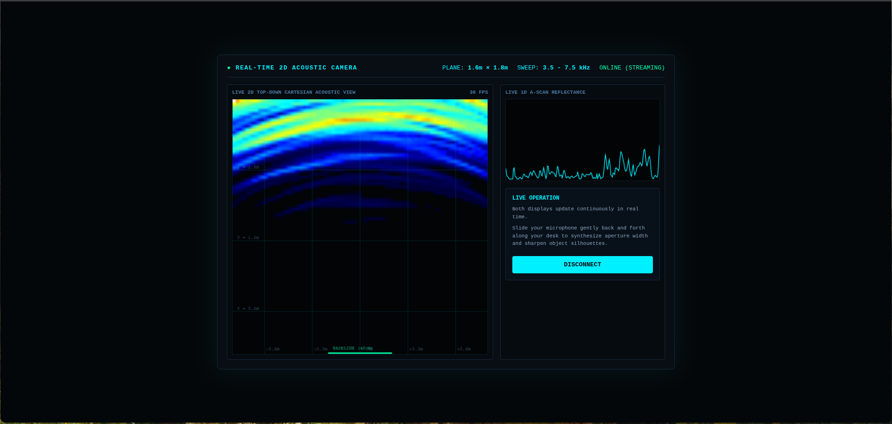

# Acoustic Camera

[](https://www.python.org/)
[](https://fastapi.tiangolo.com/)
[](#technical-specifications)
[](https://github.com/rektive)

A real-time 2D acoustic imaging and sonar visualization system using standard commercial audio hardware. The system transmits continuous FMCW (Frequency-Modulated Continuous Wave) chirps over an external wired speaker, captures incoming reflections via a single mono microphone, and reconstructs spatial profiles using a rolling Synthetic Aperture Sonar (SAS) backprojection algorithm.

Developed and maintained by **Nikita Zhuravlov**.

---

## System Architecture

```text
               +----------------------------------+
               |        Acoustic Pipeline         |
               +----------------------------------+
                                |
             [TX: 3.5 - 7.5 kHz FMCW Linear Sweep]
                                |
                                v
                       ( External Speaker )
                                |
                                ~~~> Physical Target / Reflection
                                |
                      ( Fifine ME6S Mic )
                                |
                                v
               +----------------------------------+
               | Backend Core (DSP Engine)        |
               | - Duplex Ring Buffer Stream      |
               | - FFT Matched Filter (Hilbert)   |
               | - Adaptive Background Subtractor |
               | - Delay-and-Sum Backprojection   |
               +----------------------------------+
                                |
             [Raw Binary Float32 WebSocket Stream]
                                |
                                v
               +----------------------------------+
               | Frontend (HTML5 Canvas UI)       |
               | - Live 1D A-Scan Reflectometer   |
               | - 2D Top-Down Cartesian Heatmap  |
               +----------------------------------+
```

---

## Technical Specifications

| Parameter | Specification |
| :--- | :--- |
| **Transmit Signal** | Linear FMCW Chirp (3.5 kHz → 7.5 kHz) |
| **Pulse Repetition Interval (PRI)** | 80 ms (40 ms pulse + 40 ms listening window) |
| **Sampling Rate** | 48.0 kHz, 32-bit floating point |
| **Detection Envelope** | 0.2 m → 2.0 m (Depth), ±0.8 m (Horizontal) |
| **Imaging Principle** | Synthetic Aperture Sonar (SAS) with Time-Gain Compensation (TGC) |
| **Transport** | Low-latency binary WebSocket (`Float32Array`, 4-byte memory-aligned) |
| **Frame Rate** | ~30 FPS sustained |

---
# Acoustic Camera



## Prerequisites

- **OS**: Linux (tested on Arch Linux / PipeWire / ALSA)
- **Runtime**: Python 3.10+
- **Hardware**:
  - 1x USB Microphone (e.g., Fifine AmpliGame ME6S or any mono/stereo USB condenser mic)
  - 1x Wired External Speaker (aux 3.5mm or USB; avoid Bluetooth to eliminate latency jitter)

---

## Installation

1. **Clone the repository:**
   ```bash
   git clone [https://github.com/rektive/Acoustic-Camera.git](https://github.com/rektive/Acoustic-Camera.git)
   cd Acoustic-Camera
   ```

2. **Create and activate a virtual environment:**
   ```bash
   python -m venv .venv
   source .venv/bin/activate
   ```

3. **Install system audio dependencies (Arch Linux):**
   ```bash
   sudo pacman -S portaudio alsa-utils pavucontrol
   ```

4. **Install Python dependencies:**
   ```bash
   pip install numpy scipy sounddevice fastapi "uvicorn[standard]"
   ```

---

## Hardware Configuration

Query PortAudio device indices:

```bash
python -c "import sounddevice as sd; print(sd.query_devices())"
```

Locate your microphone index (e.g., `8 ME6S: USB Audio`) and edit `backend/app/core/config.py`:

```python
# backend/app/core/config.py
input_device_index: int | None = 8      # Set to your mic's device index
output_device_index: int | None = None  # None selects system default output sink
```

> **Note:** For optimal bistatic geometry, position the speaker directly adjacent to the microphone (5–15 cm separation), pointing in the same direction toward the target area.

---

## Running the Application

### 1. Launch the Backend Server

Start the FastAPI / Uvicorn WebSocket server from the project root:

```bash
uvicorn backend.app.api.server:app --reload --port 8000
```

### 2. Launch the Web Client

Serve the frontend files using Python's static HTTP server:

```bash
cd frontend
python -m http.server 3000
```

### 3. Access the Dashboard

Open `http://localhost:3000` in any Chromium-based browser or Firefox.

1. Click **CONNECT SENSORS** to start audio streaming.
2. The UI will begin rendering:
   - **Real-Time A-Scan Monitor**: Displays live reflection peaks versus distance along the radial axis.
   - **2D Cartesian Heatmap**: Displays an $80 \times 80$ spatial grid reconstructed via delay-and-sum backprojection.
3. Slide the microphone along your desk across a 40 cm baseline to synthesize horizontal aperture and sharpen spatial targets.

---

## Project Structure

```text
Acoustic-Camera/
├── backend/
│   └── app/
│       ├── __init__.py
│       ├── api/
│       │   ├── __init__.py
│       │   └── server.py          # FastAPI app & binary WebSocket endpoints
│       └── core/
│           ├── __init__.py
│           ├── config.py          # Chirp profile, sample rate, hardware indices
│           ├── ring_buffer.py     # Thread-safe circular audio buffer
│           ├── audio_stream.py    # Duplex PortAudio callback loop
│           └── canceller.py       # Matched filter & 2D SAS backprojection engine
├── frontend/
│   ├── index.html                 # HUD interface & canvas containers
│   ├── style.css                  # Low-overhead dark terminal HUD styling
│   └── app.js                     # Binary WebSocket parser, colormaps & canvas renderer
└── README.md
```

---

## Troubleshooting

- **`Address already in use` on port 8000:**
  ```bash
  fuser -k 8000/tcp
  ```
- **No output sound:** Verify output routing in `pavucontrol`. Under the **Playback** tab, assign the `ALSA plug-in [python]` stream to your wired audio interface.
- **ALSA buffer underrun (`xrun`):** Increase `buffer_frames` in `config.py` from `1024` to `2048`.

---

## Author

**Nikita Zhuravlov**
- GitHub: [@rektive](https://github.com/rektive)
- Project: [Acoustic-Camera](https://github.com/rektive/Acoustic-Camera)
